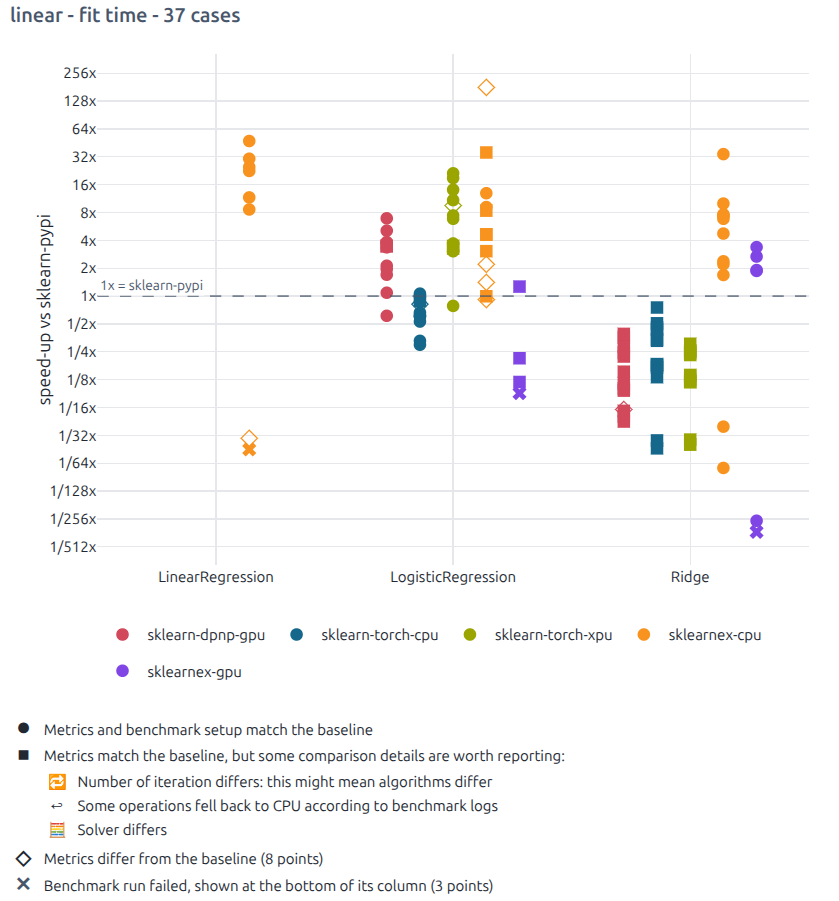
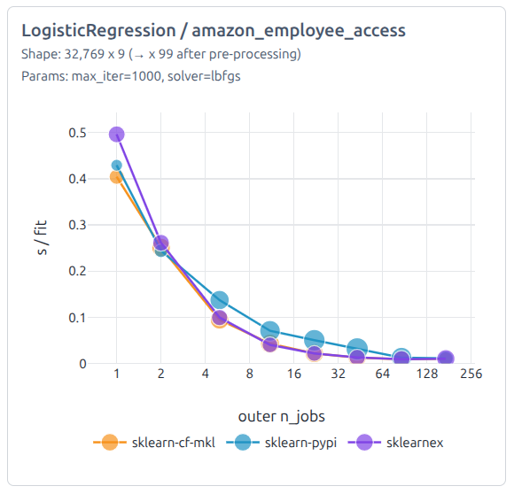
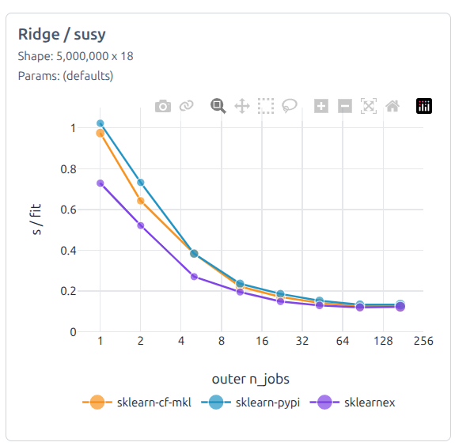

---
#### Blog Post Template ####

#### Post Information ####
title: "Accelerating scikit-learn: early findings of benchmarks on Intel hardware"
date: October 22, 2026

#### Post Category and Tags ####
# Format in titlecase without dashes (Ex. "Open Source" instead of "open-source")
categories:
  - Updates
tags:
  - Performance
  - Benchmarks
  - Open Source
  - Machine Learning

#### Author Info ####
# Can accomodate multiple authors
# Add SQUARE Author Image to /assets/images/author_images/ folder
postauthors:
  - name: Arthur Lacote
    website: https://github.com/cakedev0
    image: arthur_lacote.png
---
<div>
  
</div>

**TL;DR:**

- We care about the performance and resource use of scikit-learn, and we're
  glad that Probabl and Intel collaborate to improve them. The first
  [benchmark results](https://probabl-ai.github.io/scikit-learn-benchmarks/snapshots/v1.rc/)
  are public.
- The good news: the improvements they drive reach users through new
  releases, whether they land in scikit-learn (version 1.10 will have some of
  them) or in other projects of the ecosystem (OpenBLAS, oneDAL, PyTorch,
  joblib, loky), and not only on Intel hardware.
- If you run scikit-learn on a machine with many cores, the benchmarks show
  that it's often significantly better to use them in the outermost loop
  ([`GridSearchCV`][gridsearchcv], [`cross_validate`][cross_validate]...)
  rather than in a single model fit.

The Probabl Labs team has been working on the performance of scikit-learn
since April 2026, and this post is a first progress update. In June, at
VivaTech, Probabl and Intel
[announced a collaboration](https://blog.probabl.ai/intel-and-probabl-announce-collaboration-to-accelerate-scikit-learn-on-intel-hardware)
to make scikit-learn faster on Intel hardware: Xeon CPUs, Intel GPUs, from
high performance data center servers with hundreds of cores down to consumer
laptops.

We prioritized data center environments and use cases, where performance
directly translates into costs. For instance, if a single fit uses only 4 of
the 172 cores, the remaining 168 sit idle unless given other work, such as
running multiple fits in parallel. Below, we explain what the benchmarks
show, how to make good use of many cores and what we're now fixing to make a
single fit use more of them.

> *"Enterprises run scikit-learn at scale while performance and cost directly
> shape what they can build. Our work with Intel is about delivering
> measurable gains in both, openly and for everyone, so the whole community
> moves forward together."* —Yann Lechelle, Executive President of Probabl

## Where we are after six months

The first goal was to set up benchmarks that tell us, reliably and
repeatedly, where and how to improve performance. They live in a
[public repository](https://github.com/probabl-ai/scikit-learn-benchmarks), with
[dashboards](https://probabl-ai.github.io/scikit-learn-benchmarks/snapshots/v1.rc/)
that compare implementations, builds and machines. They can also check the
impact of scikit-learn PRs before they get merged.



*Implementations dashboard on the laptop: speed-up of each implementation over
the scikit-learn PyPI wheel, for linear model fits. Each point is one case
(estimator, dataset, parameters).*

These benchmarks have driven improvements well beyond scikit-learn. Running
scikit-learn and its alternatives on real datasets surfaced bugs and
slowdowns in other projects. We reported ~20 issues: 11 to
scikit-learn-intelex and oneDAL, the others to PyTorch's XPU backend,
OpenBLAS, joblib, loky, narwhals and conda-forge. Some came with a fix, like
the three merged in oneDAL.

In scikit-learn itself, the benchmarks showed where the time goes. Some
speed-ups are already merged, others are under review: they're described in
[What's next](#whats-next).

Meanwhile, related work landed in scikit-learn and its dependencies:
official Intel GPU support through the Python array API in
scikit-learn 1.9, threadpoolctl 3.7.0, and thread management in joblib and
loky (more at the end of this post).

So far, the value is
mostly in knowing where the problems are, and in fixing them where they live, which is
sometimes not scikit-learn. All of it happens in the open, in the upstream
projects, under their own open source licenses, so every user of these
projects benefits, whatever their hardware vendor. The fixes that land in
scikit-learn reach users when they upgrade: same API, faster on the hardware
they already have.

## A short primer on parallelism in scikit-learn

Most of what we found is about how scikit-learn uses the cores of a machine,
so here are the basics. The
[parallelism guide](https://scikit-learn.org/stable/computing/parallelism.html)
of the scikit-learn documentation has more details.

**Outer and inner parallelism.** There are usually two levels where work can
run in parallel. The outer level runs many independent fits: the candidates
of a hyperparameter search, the folds of a cross-validation. The inner level
splits a single fit across cores: the trees of a random forest, the
histograms of a gradient boosting iteration, a matrix product. Outer
parallelism is the easy kind: the fits don't need to talk to each other, so
it scales well as long as there is enough memory. Inner parallelism is
harder: the threads of a single fit have to synchronize, often thousands of
times per fit.

**Three mechanisms.** scikit-learn runs work in parallel in three ways,
sometimes within the same estimator:

- [joblib](https://joblib.readthedocs.io/), controlled by the `n_jobs`
  parameter, runs Python functions in parallel, with two backends:
  - loky, the default, uses separate processes: that's how
    [`GridSearchCV`][gridsearchcv] or [`cross_validate`][cross_validate] fit
    their candidates and folds.
  - 'threading' uses threads of the same process, which share the data
    instead of copying it. But Python's global interpreter lock (GIL) runs
    Python code in only one thread at a time, so threads only help when the
    heavy work happens in compiled code, which can release the lock. That's
    the case for the tree building of [`RandomForest*`][rf] and
    [`ExtraTrees*`][et], written in Cython, which fit their trees in threads.
- [OpenMP](https://www.openmp.org/) parallelizes loops in scikit-learn's own
  compiled code: [`HistGradientBoosting*`][hgb], [`KMeans`][kmeans], nearest
  neighbors and pairwise distances, among others. These estimators have no
  `n_jobs` parameter, and use as many threads as there are logical CPUs by
  default.
- BLAS libraries, such as OpenBLAS or MKL, run the matrix products and
  decompositions that NumPy and SciPy call. Linear models spend most of their
  time there. They are also multi-threaded by default.

The OpenMP and BLAS threads aren't set through scikit-learn's API, but with
environment variables (`OMP_NUM_THREADS`, `OPENBLAS_NUM_THREADS`,
`MKL_NUM_THREADS`) or, from Python, with
[threadpoolctl](https://github.com/joblib/threadpoolctl):

```python
from threadpoolctl import threadpool_limits

# joblib: n_jobs sets the number of workers of the outer loop
search = GridSearchCV(RandomForestClassifier(), param_grid, n_jobs=8)

# OpenMP and BLAS: an environment variable set before starting Python,
#   OMP_NUM_THREADS=4 python train.py
# or threadpoolctl, from Python
with threadpool_limits(limits=4, user_api="openmp"):
    HistGradientBoostingClassifier().fit(X, y)
```

Everything else runs on a single core: Python code, input validation, copies
and most NumPy operations outside of BLAS, and the steps of an algorithm that
depend on each other, like the iterations of a solver or of gradient
boosting. These sequential parts set a floor that more cores can't lower.

**Overhead.** Parallelism has a cost: waking threads up, splitting the work
and merging the results take time, and this cost grows with the number of
threads. When each parallel chunk of work is small, more threads can make a
fit slower.

**Oversubscription.** This is the other trap: running more threads than
cores, for instance, on a 16-core machine, 16 outer workers that each start 16
OpenMP threads: 256 threads for 16 cores. The threads then compete for the
cores, and the time goes into switching between them. To prevent it, joblib
limits the OpenMP and BLAS threads of its worker processes to
`cpu_count() // n_jobs`. Starting with the next joblib release, it will also
limit the threads that joblib itself starts inside a worker, like those of a
random forest fit
([joblib#1825](https://github.com/joblib/joblib/pull/1825)).

## Benchmark results and takeaways

Unless stated otherwise, the numbers below come from two machines provided
by Intel: a two-socket server with Intel Xeon 6787P CPUs (172 cores in total,
344 with hyper-threading, 500GB of RAM), and a laptop with an Intel Core
Ultra X7 358H CPU (16 cores) and its integrated Arc B390 GPU. How the
benchmarks work is described [further down](#how-the-benchmarks-work).

### scikit-learn-intelex is the most consistently fast option on CPU

[scikit-learn-intelex](https://uxlfoundation.github.io/scikit-learn-intelex/latest/)
(`sklearnex`) replaces some scikit-learn estimators with implementations from
the oneDAL library (both are now part of the UXL Foundation), and keeps the
scikit-learn API. Among everything we
benchmarked, it's the option that speeds up the most cases on CPU. Tree-based
models and [`KMeans`][kmeans] gain the most: `KMeans` fits are ~3x faster and never
slower than with scikit-learn 1.9. Linear models gain less. For `KMeans`, the
speed-ups coming in scikit-learn 1.10 make scikit-learn competitive with
`sklearnex` up to ~16 to 24 cores (see [What's next](#whats-next)).

It usually makes much better use of big machines. With scikit-learn, random
forests and extra trees fit ~2x to 4x faster on the 172-core server than on the
laptop. With `sklearnex`, they fit ~10x to 15x faster.

Part of the tree speed-up comes from binning: `sklearnex` uses
`max_bins=256` by default, which roughly doubles or triples the fit speed-up.
When both libraries use the same exact-split algorithm, the gap is much
smaller. This is a strong argument for adding binning to scikit-learn's
trees, see [What's next](#whats-next).

The caveat is that `sklearnex` only supports
[a subset of estimators and parameters](https://uxlfoundation.github.io/scikit-learn-intelex/latest/algorithms.html)
(it falls back to scikit-learn for the rest), and doesn't always behave exactly like scikit-learn. Running it on real
datasets, with missing values, categorical features and multiclass targets,
surfaced a number of bugs. I reported 11 issues to
[scikit-learn-intelex](https://github.com/uxlfoundation/scikit-learn-intelex)
and oneDAL, and sent fixes for some
of the tree ones.

<details markdown="1">
<summary>The most impactful issues</summary>

- [`ExtraTreesRegressor`][extratreesregressor] stopped splitting too early
  ([oneDAL#3648](https://github.com/uxlfoundation/oneDAL/issues/3648), fixed
  in [oneDAL#3649](https://github.com/uxlfoundation/oneDAL/pull/3649)).
- Best-first tree growth (`max_leaf_nodes`) expands leaves in a worse order
  than scikit-learn
  ([oneDAL#3771](https://github.com/uxlfoundation/oneDAL/issues/3771), fixed
  in [oneDAL#3772](https://github.com/uxlfoundation/oneDAL/pull/3772) and
  [oneDAL#3773](https://github.com/uxlfoundation/oneDAL/pull/3773)).
- Tree models crash when `X` has missing values at predict time but not at fit
  time
  ([sklearnex#3356](https://github.com/uxlfoundation/scikit-learn-intelex/issues/3356),
  fixed in
  [sklearnex#3357](https://github.com/uxlfoundation/scikit-learn-intelex/pull/3357)
  and
  [sklearnex#3358](https://github.com/uxlfoundation/scikit-learn-intelex/pull/3358)).
- On laptops, multinomial [`LogisticRegression`][logisticregression] on 4 threads or more stops too
  early and returns a worse model
  ([oneDAL#3820](https://github.com/uxlfoundation/oneDAL/issues/3820), with a
  fix proposed in [oneDAL#3912](https://github.com/uxlfoundation/oneDAL/pull/3912)). This
  needs to be fixed before any performance measurements.
- CPU [`Ridge`][ridge] is much slower than scikit-learn when
  `n_features > n_samples`, because it doesn't use the dual formulation like
  scikit-learn does
  ([sklearnex#3377](https://github.com/uxlfoundation/scikit-learn-intelex/issues/3377),
  with a fix proposed in [oneDAL#3899](https://github.com/uxlfoundation/oneDAL/pull/3899)).

</details>

The Intel team has been quick to respond on all of them and fixes are either
already merged or on the way for most of them.

### Builds matter: for linear models, pick MKL

This is the cheapest speed-up in this post. With conda-forge's MKL build of
scikit-learn, BLAS-bound linear model fits are commonly 1.3x to 2x faster
than with the PyPI wheel
([Builds dashboard](https://probabl-ai.github.io/scikit-learn-benchmarks/snapshots/v1.rc/builds_comparison.html#high_end_intel_xeon_server)). You don't need to change
any code, only how you install scikit-learn:

```bash
conda install -c conda-forge scikit-learn "libblas=*=*mkl"
# or, with pixi
pixi add scikit-learn "libblas=*=*mkl"
```

It's also possible to install an MKL build
[with pip, from Intel's index](https://github.com/intel/optimization-zone/tree/main/software/scikit-learn#blas-and-lapack).
If you stay on OpenBLAS, conda-forge ships it with either pthreads or OpenMP
threading, and the
[builds dashboard](https://probabl-ai.github.io/scikit-learn-benchmarks/snapshots/v1.rc/builds_comparison.html)
compares both.

The PyPI build had a much bigger problem with
[`LogisticRegression`][logisticregression], a typical case of the
overhead described [above](#a-short-primer-on-parallelism-in-scikit-learn).
On the laptop, it fitted up to ~10x slower than with the conda-forge builds,
and got slower as soon as it ran on more than one logical CPU: the OpenBLAS
bundled with scipy 1.18 wakes all its threads for the tiny triangular solves
inside L-BFGS-B, and synchronizing them costs much more than the work itself.
A more recent OpenBLAS fixes it. It ships with scipy 2.0, and should be
backported to 1.18.2
([scipy#26193](https://github.com/scipy/scipy/pull/26193#issuecomment-5886021070)).

A smaller one, but in scikit-learn itself: [`ExtraTrees`][et] fits were ~25% slower
on conda-forge than with PyPI. conda-forge compiles against the headers of an
old glibc (2.17), where `isnan` is a macro that calls a glibc function instead
of the compiler builtin. So every `isnan` in the hot loops of the trees became
a real function call
([analysis in #34869](https://github.com/scikit-learn/scikit-learn/issues/34869)).
[#34876](https://github.com/scikit-learn/scikit-learn/pull/34876) replaces it
with `x != x` and will be in the next release. Other conda-forge packages with
`isnan` in a hot loop are probably affected too, so I
[reported it to conda-forge](https://github.com/conda-forge/ctng-compiler-activation-feedstock/issues/108).

### Big servers are built for many fits at once, not for one

A many-core server is built to run many things at once. Hyperparameter
searches are where it pays off: with many fits in parallel, the server gets
through tree-based model fits ~10x to 15x faster than the laptop, close to
the ratio of physical cores (172 vs 16). Linear models gain less, from ~2x to
~12x depending on the dataset.

A single fit is a different story: the 172-core server is often no faster
than the 16-core laptop. [`Ridge`][ridge],
[`LogisticRegression`][logisticregression] and [`KMeans`][kmeans] stop
scaling after a few cores. With the same number of cores, both machines fit
these models in about the same time. With all of them, which is the default,
the server can even be slower: up to ~3x for a `Ridge` fit in our
[core-count scalability dashboard](https://probabl-ai.github.io/scikit-learn-benchmarks/snapshots/v1.rc/models_scalability.html).
Only random forests and extra trees, whose trees are built independently,
fit faster on the server. Some of this is inherent: many algorithms are hard
to split across many cores, and past a few dozen cores, memory bandwidth and
synchronization costs eat into the gains. Some of it can be improved, and that's
what software optimization work is about.

So if you work on a machine with many cores, parallelize the outer loop
(hyperparameter search, cross-validation) instead of counting on a single fit
to use all the cores, by setting `n_jobs` on the search:

```python
search = GridSearchCV(LogisticRegression(), param_grid, n_jobs=32)
search.fit(X, y)
```

On a 172-core server, that's the difference between using most of the
machine and using a few percent of it. You don't need to set the inner
threads yourself: joblib caps the OpenMP and BLAS threads of each worker to
`cpu_count() // n_jobs`, so the fits don't oversubscribe the machine.

The
[hyperparameter search scalability dashboard](https://probabl-ai.github.io/scikit-learn-benchmarks/hptuning_scalability.html)
shows this on the Xeon server. With `n_jobs=1`, the search runs its fits one
after the other, and each fit tries to use all 172 cores, with little
success. With `n_jobs=172`, it runs 172 fits at once, one per core. For a
[`LogisticRegression`][logisticregression] on a small dataset, the second way
gets through the fits ~40x faster. A [`Ridge`][ridge] on the 5 million rows
of SUSY gains less, ~8x, and little past ~40 workers: its fits likely compete
for memory bandwidth.

<figure class="half">
  
  
</figure>

*Hyperparameter searches on the Xeon server: wall time of the search divided
by its number of fits, vs the outer `n_jobs` (log scale), for three
implementations. The marker size is the CPU load.*

### `HistGradientBoosting`: the optimal number of threads depends on the data

This is the clearest example of a thread-management problem. On the Xeon
server, the optimal number of threads for a [`HistGradientBoosting*`][hgb] fit depends
on the shape of the data: 1 thread for the smallest workloads, 4 to 8 for
medium ones, 16 to 64 for the largest. Past that point, fits get slower: every workload is 2x to 30x slower
on 128 or 172 threads than on its optimal thread count. And by default, HGB uses
all the cores of the machine.

Until the fix lands, you can cap its OpenMP threads with threadpoolctl:

```python
with threadpool_limits(limits=8, user_api="openmp"):
    HistGradientBoostingClassifier().fit(X, y)
```


*`HistGradientBoosting` fit time on the Xeon server, split by phase, for two
real datasets of ~500k samples. One can observe that fit duration decreases
when going from 1 to 8 or 16 threads depending on the shape of the data, and
beyond that point thread scheduling overhead dominates to the point of
degrading performance, especially on many-core hosts.*

In short, a single HGB fit typically runs thousands of small OpenMP
parallel regions
whatever the size of the data, and with many threads, starting a region might cost
more than the work inside it. That cost also depends on the OpenMP runtime and
settings, which differ between builds. On the laptop, the conda-forge builds get worse slowdowns because
they use a more recent OpenMP runtime than the PyPI wheels. I wrote down what
I know about it in [#34764](https://github.com/scikit-learn/scikit-learn/issues/34764).

[#34935](https://github.com/scikit-learn/scikit-learn/pull/34935) implements
different strategies to better utilize OpenMP threads. In our benchmarks, it
gives 2x to 10x speed-ups for small and medium datasets on the server and on
laptops with conda-forge-like OpenMP settings. It's still under review, and the
full story will get its own blog post.

### Other issues found and fixed along the way

- [An OpenBLAS crash](https://github.com/OpenMathLib/OpenBLAS/issues/5958)
  with [`KMeans`][kmeans] on the 344-logical-CPU server, fixed recently by
  [OpenBLAS#6105](https://github.com/OpenMathLib/OpenBLAS/pull/6105), which
  will ship in the next OpenBLAS release.
- [Wrong physical core counts in loky](https://github.com/joblib/loky/issues/639)
  under CPU affinity.
- In PyTorch's Intel GPU backend, a
  [50x to 80x slowdown in `matmul`](https://github.com/intel/torch-xpu-ops/issues/4805)
  and
  [bad precision for float64 matrix-vector products](https://github.com/pytorch/pytorch/issues/182282).

## How the benchmarks work

We needed benchmarks to profile realistic cases, to measure the impact of
scikit-learn PRs before merging them, and to show users the trade-offs
between implementations, builds and machines. Existing benchmarks answered
other questions. For instance, the
[scikit-learn workload of the Phoronix Test Suite](https://openbenchmarking.org/test/pts/scikit-learn),
which many hardware reviews use, still runs the benchmark scripts of
scikit-learn 1.2.2, where [`HistGradientBoosting`][hgb] gets up to ~20x
slower on a 64-core server than on a laptop: that says more about thread
management than about the hardware. Intel's
[scikit-learn_bench](https://github.com/IntelPython/scikit-learn_bench) was a
better starting point: our suite started as a fork of it, before
growing into its own project.

The suite fits and predicts with a restricted set of important estimators:

- Linear models: [`LinearRegression`][linearregression], [`Ridge`][ridge]
  and [`LogisticRegression`][logisticregression]
- Tree-based models: [`RandomForest*`][rf], [`ExtraTrees*`][et] and
  [`HistGradientBoosting*`][hgb] (classifiers and regressors)
- Clustering: [`KMeans`][kmeans]

They run on synthetic datasets covering a matrix of shapes, and on around 15
public
[real datasets](https://github.com/probabl-ai/scikit-learn-benchmarks/blob/ecbfe88a4da603aa3deb2a14df394376c27412ab/configs/_real_datasets.py)
(covtype, SUSY, Ames housing, KDD Cup 2009...) with realistic preprocessing
and tuned hyperparameters. Each case runs in several environments, all locked
with [pixi](https://pixi.sh):

- Builds of scikit-learn: the PyPI wheel, and conda-forge with MKL or with
  OpenBLAS.
- [scikit-learn-intelex](https://uxlfoundation.github.io/scikit-learn-intelex/latest/),
  on CPU and Intel GPU.
- [Python array API](https://scikit-learn.org/stable/modules/array_api.html)
  backends: [PyTorch](https://pytorch.org/) (CPU,
  [Intel XPU](https://docs.pytorch.org/docs/stable/notes/get_start_xpu.html),
  [NVIDIA CUDA](https://docs.pytorch.org/docs/stable/notes/cuda.html),
  [Apple MPS](https://docs.pytorch.org/docs/stable/notes/mps.html)),
  [dpnp](https://github.com/IntelPython/dpnp) and [CuPy](https://cupy.dev/).

Comparing fairly is the hard part: `sklearnex` random forests bin the
features by default, solvers stop after different numbers of iterations, and
some backends silently fall back to scikit-learn. So each run records its
metrics, setup, hardware and software stack, and the dashboards flag every
case where the setup or the metrics differ from the baseline.

The results are split into dashboards that each vary one thing:
[implementations](https://probabl-ai.github.io/scikit-learn-benchmarks/snapshots/v1.rc/per_hardware.html),
[builds](https://probabl-ai.github.io/scikit-learn-benchmarks/snapshots/v1.rc/builds_comparison.html),
[hardware](https://probabl-ai.github.io/scikit-learn-benchmarks/snapshots/v1.rc/hardware_comparisons.html),
[core-count scalability](https://probabl-ai.github.io/scikit-learn-benchmarks/snapshots/v1.rc/models_scalability.html),
[hyperparameter search scalability](https://probabl-ai.github.io/scikit-learn-benchmarks/hptuning_scalability.html),
and a
[breakdown of `HistGradientBoosting` fits](https://probabl-ai.github.io/scikit-learn-benchmarks/snapshots/v1.rc/hgb_scaling.html)
by phase. Every point can be hovered, and links to the exact timings, metrics
and warnings.

The same machinery also benchmarks scikit-learn pull requests before they get
merged. This is for instance how I measured the speed-up of the new k-means++
initialization of [`KMeans`][kmeans]
([example](https://github.com/probabl-ai/scikit-learn-benchmarks/pull/144)).

## What's next

Here are our priorities for the next months, in order, and where each one
stands. The biggest pieces will get their own blog post.

**`HistGradientBoosting` scalability.** Get
[#34935](https://github.com/scikit-learn/scikit-learn/pull/34935) (see above)
merged, and make the tools developed for it available in threadpoolctl.

**`KMeans`.** Looking at why `sklearnex` is so much faster on [`KMeans`][kmeans] led to
two PRs, the most promising speed-ups so far. On the Xeon server, the
k-means++ initialization took most of the fit time.
[#35140](https://github.com/scikit-learn/scikit-learn/pull/35140), merged and
coming in scikit-learn 1.10, makes it ~8x to 20x faster in our benchmarks. The Lloyd
iterations that follow stopped scaling at ~16 threads, because of costs that
grow with the number of threads.
[#35193](https://github.com/scikit-learn/scikit-learn/pull/35193), still under
review, removes them, and makes the iterations several times faster on the
server. Together with
[OpenBLAS#6105](https://github.com/OpenMathLib/OpenBLAS/pull/6105), they
should also close a long-standing issue,
[#17334](https://github.com/scikit-learn/scikit-learn/issues/17334). This
story might get its own blog post.

**Documentation.** Many of the findings above (which build to install or how
to set threads) belong in the
[performance](https://scikit-learn.org/stable/computing/computational_performance.html)
and [parallelism](https://scikit-learn.org/stable/computing/parallelism.html)
guides of the scikit-learn documentation, with a section for Intel users,
from laptops to data center servers.

**Trees.** Binning is one of the main reason `sklearnex`'s random forests are faster,
and the next big item is to add it to scikit-learn's [`RandomForest*`][rf] and
[`ExtraTrees*`][et]. In parallel, I'm experimenting with faster sorting for exact
splits: SIMD sort and radix sort. Radix sort gives very promising results.
I'm also [experimenting](https://github.com/cakedev0/scikit-learn/pull/19)
with free-threaded Python: with a lower-overhead thread pool, forest fits on
the 172-core server get ~2.5x faster (median) than with the GIL.

**Encoders.** Profiling a typical tabular pipeline showed [`OneHotEncoder`][onehotencoder] and
[`OrdinalEncoder`][ordinalencoder] could take a surprising share of the time in some settings.
Itamar Turner-Trauring sped up unique value counts for strings
([#34386](https://github.com/scikit-learn/scikit-learn/pull/34386)). I made
the encoders work on F-ordered data
([#34392](https://github.com/scikit-learn/scikit-learn/pull/34392)). The next
step, [#34678](https://github.com/scikit-learn/scikit-learn/pull/34678), tries
to leverage the internal encoding of pandas categorical columns, but getting
every edge case to behave exactly as on `main` turned out to be complex, so
it's paused for now.

**Linear models.** Copies of `X` can take a large share of the fit time of
linear models: they are slow, single-threaded and double the peak memory,
while the rest of the fit runs in multi-threaded BLAS. So we're looking for
the copies that can be avoided.

**Benchmarks.**

- More estimators: `PCA`, `LogisticRegressionCV` and `RidgeCV`.
- XGBoost, LightGBM and CatBoost, to compare [`HistGradientBoosting*`][hgb] with them
  systematically.
- Discrete Intel GPUs, and more CUDA results to compare them with.
- A new version of the Phoronix scikit-learn workload, based on a subset of
  these cases, that we'd like to create in collaboration with the Phoronix
  maintainers.

**Threads and the Python array API.** These are related workstreams.
Itamar Turner-Trauring (Quansight) and Olivier Grisel (Probabl)
work on how scikit-learn and its dependencies manage threads, in particular
for free-threaded Python:
[threadpoolctl 3.7.0](https://github.com/joblib/threadpoolctl/blob/master/CHANGES.md#370-2026-09-15)
can now set thread-local limits for MKL and OpenBLAS, loky detects physical
cores better on big machines, and the next joblib release will be
[thread-safe](https://github.com/joblib/joblib/pull/1834) and
[protect against nested oversubscription](https://github.com/joblib/joblib/pull/1825).
Python array API support also keeps progressing, with an Intel GPU CI in
[scikit-learn-intel-workflow](https://github.com/probabl-ai/scikit-learn-intel-workflow).

If you run scikit-learn on big machines, or see a result that doesn't match
your experience, please
[open an issue](https://github.com/probabl-ai/scikit-learn-benchmarks/issues).
I'm particularly curious about workloads where a single fit on many cores
matters to you: so far, most of our cases suggest that the outer loop is
where the cores should go.

## Acknowledgements

This work is funded by Intel as part of its collaboration with Probabl. The
infrastructure work on threading parallelism in scikit-learn is also
supported by NASA through the ROSES grant 80NSSC25K7215, "Ensuring a fast and
secure core for scientific Python".

Thanks to [Olivier Grisel](https://github.com/ogrisel) for the guidance and
the reviews, to [Itamar Turner-Trauring](https://github.com/itamarst) for the
encoders and threading work, and to the scikit-learn-intelex and oneDAL
maintainers at Intel for providing the hardware, and for their quick answers
and fixes, in particular [David Cortes](https://github.com/david-cortes-intel).

[cross_validate]: https://scikit-learn.org/stable/modules/generated/sklearn.model_selection.cross_validate.html
[et]: https://scikit-learn.org/stable/modules/ensemble.html#extremely-randomized-trees
[extratreesregressor]: https://scikit-learn.org/stable/modules/generated/sklearn.ensemble.ExtraTreesRegressor.html
[gridsearchcv]: https://scikit-learn.org/stable/modules/generated/sklearn.model_selection.GridSearchCV.html
[hgb]: https://scikit-learn.org/stable/modules/ensemble.html#histogram-based-gradient-boosting
[kmeans]: https://scikit-learn.org/stable/modules/generated/sklearn.cluster.KMeans.html
[linearregression]: https://scikit-learn.org/stable/modules/generated/sklearn.linear_model.LinearRegression.html
[logisticregression]: https://scikit-learn.org/stable/modules/generated/sklearn.linear_model.LogisticRegression.html
[onehotencoder]: https://scikit-learn.org/stable/modules/generated/sklearn.preprocessing.OneHotEncoder.html
[ordinalencoder]: https://scikit-learn.org/stable/modules/generated/sklearn.preprocessing.OrdinalEncoder.html
[randomforestclassifier]: https://scikit-learn.org/stable/modules/generated/sklearn.ensemble.RandomForestClassifier.html
[randomizedsearchcv]: https://scikit-learn.org/stable/modules/generated/sklearn.model_selection.RandomizedSearchCV.html
[rf]: https://scikit-learn.org/stable/modules/ensemble.html#random-forests
[ridge]: https://scikit-learn.org/stable/modules/generated/sklearn.linear_model.Ridge.html
